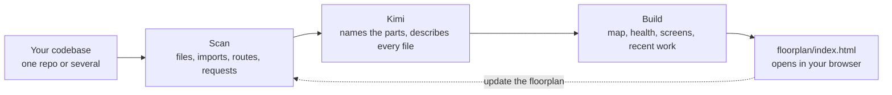

<div align="center">

<picture>
  <source media="(prefers-color-scheme: dark)" srcset="docs/images/logo-dark.png">
  
</picture>

# Floorplan

**See how your app actually fits together.**

Kimi reads your codebase and draws an interactive map of it. Every part, file and web request gets a plain-English name, and every connection between them is shown.

[](https://www.kimi.com/code/docs/en/kimi-code-cli/customization/plugins.html)
[](https://github.com/urfv/floorplan/actions/workflows/test.yml)
[](CHANGELOG.md)
[](LICENSE)
[](https://nodejs.org)
[](#how-it-works)

[Install](#install) · [Quick start](#quick-start) · [Features](#features) · [How it works](#how-it-works) · [Docs](docs/README.md) · [FAQ](#faq)

</div>

This is a Kimi-native fork of [Hayden Smith's Floorplan](https://github.com/haydenschmitty/floorplan). It removes the hosted waitlist and Claude-specific runtime, keeps the map fully offline, and uses a read-only Kimi agent for questions.

## Why Floorplan?

You built an app, probably with a lot of help from AI, and it works. But ask "what happens when someone checks out?" or "what breaks if I change this?" and the honest answer is often *no idea*.

Floorplan gives you the diagram nobody drew. Ask Kimi for a floorplan and a few minutes later you have a map you can explore, ask questions on, and keep up to date as you work.

- **For builders:** understand the app you made without reading every file.
- **For teams:** onboard someone from the big picture down to the exact file.
- **For working with Kimi:** after every change, see which parts it touched and why.

## Features

- **A map at every zoom.** Start with the whole app, then go into a part, a group of files, a file and its endpoints. Each view shows what it uses and what uses it.
- **Plain English everywhere.** Technical terms are explained on hover, and one switch shows the developer view.
- **Real connections across repos.** Follow imports and match frontend web requests to server endpoints, even across separate repos.
- **Start from a screen.** Pick a page and see its components, requests, server code, data and outside services.
- **Ask the map.** Get an answer plus a mini-map of the relevant pieces and an optional step-by-step walkthrough.
- **Health check.** Find likely secrets in code, endpoints without sign-in checks, unused files and files too large to edit safely.
- **Recent work.** Cards Kimi just changed light up green, with notes explaining how each change serves your request.
- **Local and current.** Updates re-read only what changed, open maps reload, and all map assets are bundled for offline use.


## Install

You need [Kimi Code](https://www.kimi.com/code/docs/en/) and [Node.js 18+](https://nodejs.org).

Inside Kimi Code, run:

```text
/plugins install https://github.com/urfv/floorplan
```

Then run `/reload` or start a new session. The plugin is installed for your user and is available in all projects.

## Quick start

1. Open your project in Kimi Code. For a frontend and backend in separate repos, open the folder that holds both.
2. Ask:
   > Make me a floorplan of this app.
3. Explore. The map opens on its own, starting with a short tour.

You can also invoke the skill explicitly as `/skill:floorplan:floorplan`.

When you've done more work, ask:

> Update the floorplan.

Only changed files are re-read, and recent work lights up on the map.

| Ask Kimi | Ask the map |
|---|---|
| "Make me a floorplan of this app" | "What happens when someone places an order?" |
| "Update the floorplan" | "Where do we talk to Stripe?" |
| "Fix the important Health issues" | "If I change the users table, what breaks?" |
| "Add a flow showing how a new user signs up" | "Which files handle login?" |
| "Rewrite the floorplan for developers" | "What did we change for refunds?" |

## How it works



Scripts do the mechanical work: finding repos, parsing code, matching requests to endpoints and laying out the map. They're plain Node with no dependencies. Kimi does the reading: deciding what the parts of your app *are* and describing them plainly. Details in [How it works](docs/how-it-works.md).

**Languages:** TypeScript, JavaScript, Python, Go, Rust, Java, Kotlin, Scala, Vue, Svelte and Astro, with lighter support for others.<br>
**Endpoints:** Express, Koa, Hono, Next.js, Flask, FastAPI, Django, Go's net/http, Gin, Echo and chi, Actix, Axum and Spring.<br>
**Screens:** Next.js, React Router, Vue, SvelteKit, Remix, Nuxt, Astro, Expo, Angular and TanStack.

## What it adds to your project

Only a self-ignoring `floorplan/` folder. Floorplan does not modify `AGENTS.md`, `.kimi-code/`, `.gitignore`, `.git/info/exclude` or Claude configuration files. See [What's in your project](docs/project-files.md).

## Privacy and security

- Scanning, building and the local map server run on your computer. The server listens on `127.0.0.1` only.
- The map works offline: its layout engine and fonts are embedded. There are no analytics, telemetry, waitlist or upsell requests.
- API calls require a random per-start token in an HTTP header, including the live-reload event stream. Tokens never go in query strings.
- Static file serving uses canonical path checks, including protection against traversal and symlink escapes.
- Questions use your own Kimi account through a custom agent restricted to `Read`, `Grep` and `Glob`; it has no shell or file-writing tools.
- Health findings never store or show secret values.

More in [Privacy and security](docs/privacy-and-security.md).

## Documentation

| | |
|---|---|
| [Getting started](docs/getting-started.md) | Install, first map, updating, removing |
| [Using the map](docs/using-the-map.md) | Views, buttons, shortcuts and menus |
| [How it works](docs/how-it-works.md) | The pipeline, matching, refreshes and Ask |
| [What's in your project](docs/project-files.md) | Every file Floorplan creates |
| [Privacy and security](docs/privacy-and-security.md) | What runs where and server protections |
| [Troubleshooting](docs/troubleshooting.md) | Common problems and fixes |
| [Developing Floorplan](docs/development.md) | Repo layout, local installs and releases |

## FAQ

**Does my code leave my computer?** Only as part of your normal Kimi Code session: Kimi reads files it needs through your own account. Floorplan itself has no hosted service and makes no analytics or upsell requests.

**What does it cost?** Building descriptions and answering questions use your Kimi plan like any other task. Scanning and building the map are local Node scripts and cost no tokens.

**Do I need the Kimi CLI?** The static map works without it. The CLI is required for Ask and for generating new flows from the map.

**Will it change or commit my files?** It writes only its own ignored `floorplan/` folder. It never modifies your source code or agent configuration.

**Can I edit names and structure?** Yes. Ask Kimi or edit `floorplan/architecture.json` and `floorplan/descriptions/`; your edits are kept on updates.

## License

MIT, like the upstream project. See [LICENSE](LICENSE) and the bundled third-party licenses under `skills/floorplan/assets/vendor/`.
