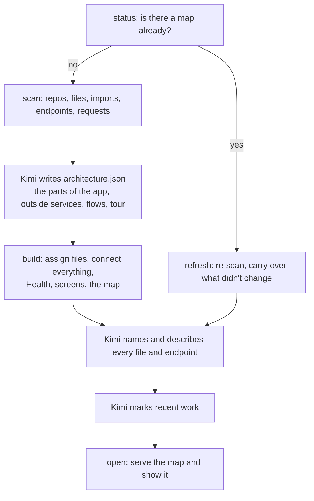

# How it works

Floorplan splits the work between scripts and Kimi. The scripts do everything mechanical: finding files, parsing code, matching requests to endpoints, laying out the map. They're plain Node.js with no dependencies, and they cost no tokens. Kimi does what only a reader of the code can: deciding what the parts of your app *are*, and explaining them plainly.

## 1. Scan

`scan.mjs` finds every git repository under the folder you point it at (one repo, a monorepo, or several repos side by side), skipping duplicate worktrees. It lists files with git, so your `.gitignore` is respected, then extracts from each file:

- **imports**, resolved to real files: TypeScript path aliases, Python packages, Go modules, Rust crates, JVM packages;
- **exported definitions** and their doc comments;
- **endpoints** the server defines;
- **web requests** the code makes;
- content **fingerprints**, so later updates can tell what changed.

Supported languages: TypeScript and JavaScript (including Vue, Svelte and Astro files), Python, Go, Rust, Java, Kotlin, Scala and Groovy, with lighter support for others.

## 2. Connecting requests to endpoints

The most useful lines on the map connect a screen's web requests to the server code that answers them, often across repos. Floorplan:

- **Finds endpoints** in Express, Koa, Hono, Next.js (route files and API routes), Flask, FastAPI, Django, Go (net/http, Gin, Echo, chi, Fiber), Actix, Axum and Spring.
- **Resolves prefixes**: Flask blueprints registered with a `url_prefix`, and Express routers mounted with `app.use('/api/users', usersRouter)`, including routers mounted inside other routers and mounts with middleware in front.
- **Finds requests** made with `fetch`, axios, ky, `requests` and similar, including:
  - addresses built in a variable first: `const url = …; api.get(url)`;
  - template strings with nested parts;
  - small helpers in the same file that add a prefix, like `call('/definitions')`.
- **Matches** the two. When a request only spells out part of the address, because the base URL lives in settings, Floorplan learns each client's base path and prefers matches that fit it.

It's pattern matching, not a compiler, so it catches most connections but not all. If an important link is missing, ask Kimi to add it to the floorplan, and it will record it as an explicit connection.

## 3. Kimi describes the system

Kimi reads the scan summary, READMEs, setup files and entry points, then writes `architecture.json`:

- the main parts of your app, each with a plain summary;
- the outside services it really talks to (databases, payment providers, email);
- connections the scan can't see, like queues, scheduled jobs and webhooks;
- a few guided flows and a "Start here" tour.

The build then assigns every file to the deepest part whose patterns match, and reports anything left over.

Next, `describe.mjs` writes a worksheet for each part. A worksheet is a digest of every file and endpoint: what it defines, its doc comments, what it uses and what uses it. Kimi fills in a name and description for each. On large projects, the worksheets are split across parallel Kimi helpers.

By default everything is written for the app's owner, not an engineer: what each thing does for the business, in everyday words. Ask for a developer-facing map and it switches to technical style.

## 4. Build

`build.mjs` validates everything Kimi wrote and reports problems by name ("did you mean …"). It then:

- connects the parts, using imports, matched requests and Kimi's explicit connections;
- runs the **Health** check;
- detects **screens**: Next.js, React Router, Vue, SvelteKit, Remix, Nuxt, Astro, Expo, Angular, TanStack;
- writes `graph.json` and the self-contained `index.html`.

The map lays itself out in your browser with [ELK](https://eclipse.dev/elk/), so the build itself is fast.

## 5. Recent work

After every make or update, Kimi records what was just worked on in `recent-work.json`. `recent.mjs` lists the facts: what changed since the last map, uncommitted changes, and recent commits, each matched to its card. Kimi adds the *why*: what you asked for, and how each change serves it. The previous highlights are replaced every time.

## 6. Showing it

`open.mjs` starts the map's small local server in the background and opens your browser. If the server is already running for this map, it's reused, and any open tab reloads itself in place instead of a new one opening.

## Updates

`refresh.mjs` re-scans and compares against the last build, using each file's fingerprint:

- **exact content**, which spots edits, renames and moves;
- **signature**: its exports, endpoints and doc comments. Edits inside function bodies don't count.

It then:
- carries descriptions over to moved and renamed files and endpoints;
- drops entries for deleted files;
- flags entries whose signature changed for Kimi to review.

Then it rebuilds. Kimi only has to describe what's new or flagged, and check the structure if the change was large. That's why updates are quick.

## Asking questions

With the Kimi Code CLI, the map's server runs `kimi -p --output-format stream-json` in your project for each question. A custom agent restricts the session to `Read`, `Grep` and `Glob`: no shell, file writes or delegation. The server supplies a compact map catalogue and a JSON schema, and Kimi answers with text plus the cards to show, citing real code when needed. Follow-ups resume the same Kimi session.

The standalone `floorplan/query.mjs` remains available for map lookups (`find`, `show`, `path`, `overview`) without modifying any project instruction files.
